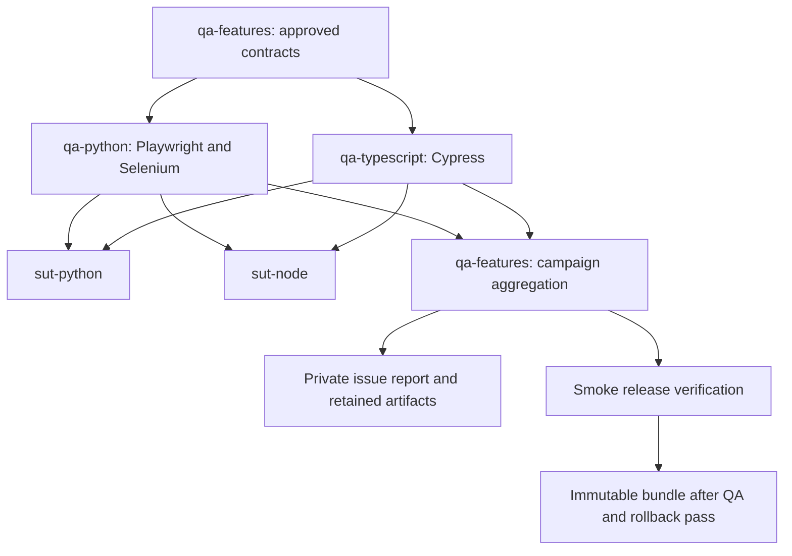
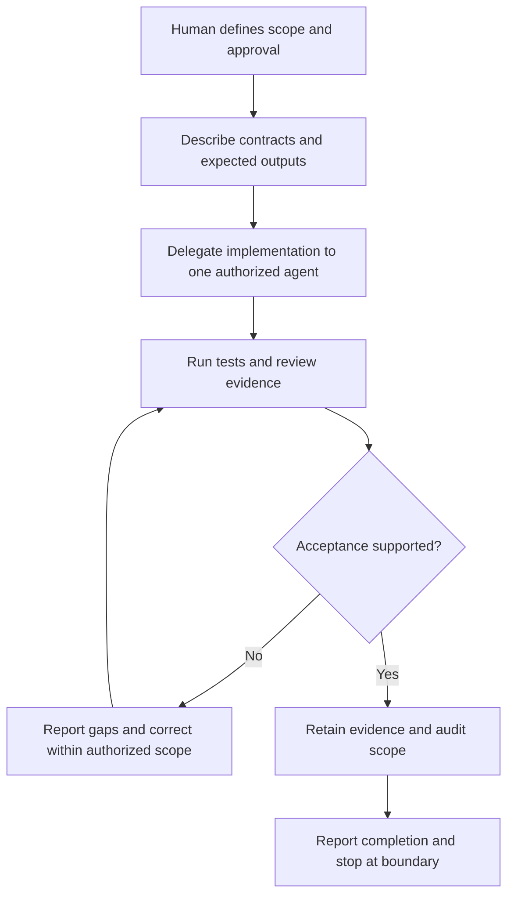

# AI-Assisted Test Automation — A Development Showcase

This project showcases how to design, build, and validate test automation frameworks with AI assistance, applying the four Ds: **Description, Delegation, Discernment, and Diligence**.

Playwright, Selenium, and Cypress provide three example implementations of the same authentication specification. Readers can study and adapt the approach that fits their project. The combined test campaign verifies the showcase examples; using all three frameworks together is not an adoption requirement.

## What you can learn

- Define shared acceptance criteria independently of a test framework.
- Build test automation frameworks using Playwright, Selenium, or Cypress.
- Capture observations and distinguish verified outcomes from missing evidence.
- Develop reporting that handles failures and reruns responsibly.
- Validate implementations with repeatable execution, reproduction, and rollback evidence.

AI assists development. The QA workflows execute deterministic tests without runtime model calls or auto-healing. The example feature, **SEED-1**, covers registration, successful login, and rejected login.

## Choose an example to explore

| Interest | Start here |
|---|---|
| Playwright or Selenium implementation | [Python automation examples](https://github.com/camiloavilacm/qa-python) |
| Cypress implementation | [TypeScript automation example](https://github.com/camiloavilacm/qa-typescript) |
| Shared specification and acceptance criteria | [Authentication scenarios](features/auth/login.feature) and [API contract](openapi.yml) |
| Human–AI development practices | [The four Ds](#how-we-work-with-ai-the-four-ds) and [development harness](harness/README.md) |

## How the showcase is validated

The Python and Node reference applications provide consistent targets for demonstrating the example frameworks against the same contract. A **system under test (SUT)** is the application being tested. Each repository has one responsibility:

| Repository | Responsibility |
|---|---|
| [qa-features](https://github.com/camiloavilacm/qa-features) | Shared contracts, development governance, campaign aggregation, reporting, and release orchestration |
| [sut-python](https://github.com/camiloavilacm/sut-python) | Python reference application with PostgreSQL and the shared frontend |
| [sut-node](https://github.com/camiloavilacm/sut-node) | Node reference application implementing the same contract |
| [qa-python](https://github.com/camiloavilacm/qa-python) | Playwright and Selenium runners |
| [qa-typescript](https://github.com/camiloavilacm/qa-typescript) | Cypress runner |

All five repositories are private and independent; access is required to follow their links or execute hosted workflows.

The diagram shows the showcase’s validation infrastructure. Its combined campaign checks all examples: **2 applications × 3 frameworks × 3 scenarios = 18 scenario results**.



Runners pin the approved specification through a Git submodule. Orchestration separately pins application, runner, and tooling revisions. A missing or invalid observation cannot count as a pass.

## How we work with AI: the four Ds

The project applies the four competencies of the [AI Fluency Framework by Rick Dakan, Joseph Feller, and Anthropic](https://www-cdn.anthropic.com/b383cf6baddbfc72fdf8b0ed533a518e2872d531.pdf):

| Competency | Meaning | How we apply it |
|---|---|---|
| **Description** | Communicate clearly with AI. | Define contracts, acceptance criteria, allowed changes, and expected outputs before implementation. |
| **Delegation** | Decide what to do with AI vs. yourself. | Humans approve scope and features. One authorized agent implements within its assigned boundary. |
| **Discernment** | Evaluate what AI gives you. | Review changes and inspect actual tests, observations, failures, and missing evidence. |
| **Diligence** | Use AI responsibly and accountably. | Retain authorization, ownership, sanitized evidence, provenance, and scope audits. Humans remain accountable. |



The [development harness guide](harness/README.md) explains authorization, provider adapters, registered checks, and ownership. These practices support the four Ds; they do not eliminate the need for human judgment.

## Start here

### Explore and validate the specification

Read the [authentication scenarios](features/auth/login.feature), [API contract](openapi.yml), and [selectors](selectors.json). From this repository root, with Python and Hurl/hurlfmt available:

```sh
python3 -m venv .venv
.venv/bin/python -m pip install -r tools/validate/requirements.txt
.venv/bin/python tools/validate/validate.py --check all
```

This validates specification structure and fixtures. It does not execute either application or establish browser acceptance.

### Validate all examples with a hosted campaign

An operator needs authenticated GitHub CLI access to the private repository and workflows. The configured Actions environment also needs the documented read-only source deploy keys and package permissions. See the [campaign guide](tools/campaign/README.md) before dispatching:

```sh
.venv/bin/python tools/campaign/launch.py dispatch --record /absolute/path/to/campaign-run.json --report-issue 1
.venv/bin/python tools/campaign/launch.py wait --record /absolute/path/to/campaign-run.json
.venv/bin/python tools/campaign/launch.py download --record /absolute/path/to/campaign-run.json --output /absolute/path/to/new-campaign-archive
```

The development campaign defaults to private issue #1; smoke reporting defaults to #2. A configured issue must already exist. Reruns update the same campaign comment without changing issue fields. Archive each attempt in a fresh directory.

## What has been demonstrated

Validation of the showcase across seven implementation steps and four subsequent architecture fixes established real hosted execution of all 18 scenarios, failed-rerun reporting, configured report destinations, independent bundle reproduction, and baseline → candidate → baseline rollback on both applications.

Acceptance checks inspect source and image provenance, complete observations, and actual outcomes. The [release guide](tools/release/README.md) describes the evidence and reproduction procedure. Historical results apply to their recorded revisions; they are not a guarantee about every future change.

The approved feature tag `seed-1-approved-v1` points to `12a55fb4b9312303378af72f96a28734b6b9ec9a`. The [approval receipt](governance/approvals/seed-1-approved-v1.json) and [original approval-time README](docs/seed-1-approval-history.md) preserve its history.

### Current limits

- The smoke profile is synthetic Ubuntu 24.04, Linux/amd64. It demonstrates image rollback with an unchanged database schema; it does not establish production readiness or schema-migration rollback.
- Live Claude operation remains **NOT RUN** under the approved artifacts-only exception.
- A fresh development checkout requires operator activation. Committed harness state is a distribution snapshot, not permission to begin work.

## Agent Control and visual exploration

[Agent Control](https://github.com/agentcontrol/agent-control) is being assessed as a possible supplement to development governance. It is **not integrated**. Read the [capability assessment and recommendation](docs/agent-control-evaluation.md).

The diagrams above are maintained Mermaid source rendered by GitHub. [GitDiagram](https://github.com/ahmedkhaleel2004/gitdiagram) is an optional tool for exploring individual repositories. Its [private repository guidance](https://gitdiagram.com/guides/private-repository-diagram) explains access requirements. Using it is a separate operator choice involving access to private source; no external diagram service is required to read this README. Review generated diagrams against the actual code, especially the boundaries between repositories.

## Further reading

- [Campaign execution and reporting](tools/campaign/README.md)
- [Smoke releases, reproduction, and rollback](tools/release/README.md)
- [Development harness and contribution procedure](harness/README.md)
- [Master contract](MASTER-CONTRACT.md)
